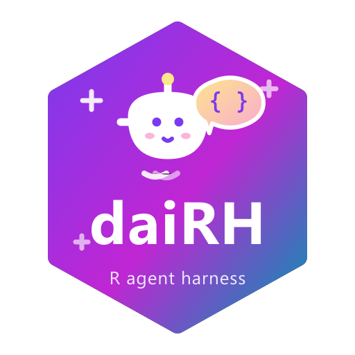

# DaiRH — RStudio LLM Agent 对话助手

<p align="left">
  
</p>

把一个能**读写文件、运行代码、查文档**的对话式编程 Agent 直接装进 RStudio 的 Viewer 面板。

- 任何 **OpenAI 兼容**端点都能接：Ollama（本机/局域网）、DeepSeek、智谱 GLM、Kimi、OpenAI、自建网关都只是"填 `base_url` + 模型名"的事
- 底层流水线：[ellmer](https://ellmer.tidyverse.org)（对话/工具调用）+ [shinychat](https://posit-dev.github.io/shinychat/)（流式聊天气泡）+ [callr](https://callr.r-lib.org)（子进程安全执行）

## 安装

```r
# 方式一：源码直装（推荐；注意 Windows 下对本地目录用 type="source"，
# win.binary 的打包-解包路线在部分机器上会报 unzip 错误）
install.packages("path/to/daiRH", repos = NULL, type = "source")

# 想装进系统库而不是用户库，加 lib 参数：
# install.packages("path/to/daiRH",
#                  repos = NULL, type = "source",
#                  lib = .Library)

# 方式二：命令行
# "R.exe" --vanilla CMD INSTALL --no-multiarch path/to/daiRH

# 方式三：devtools
devtools::install("path/to/daiRH")
```

## 使用

装好后重启 R 一次（让 RStudio 扫描 Addin），然后：

1. **Tools → Addins → DaiRH Chat**：在 Viewer 面板打开对话助手
2. **Tools → Addins → DaiRH Settings**：配置 provider / 模型 / Key
3. **（强烈建议绑快捷键）Tools → Addins → daiRH Send Selection**：选中代码后
   一键直发面板讲解（Tools → Modify Keyboard Shortcuts 搜 daiRH 绑定）。
   面板里的"讲解选中代码"按钮走快照式上下文，快照只在控制台**运行真实代码**
   时刷新（空回车不保证触发）
4. 面板顶部两个图标：**🧹 清空对话**（= 开新会话：重置 Agent 会话与单轮硬预算，
   不重启面板子进程；后台模式下当前会话先存入历史抽屉、可随时找回）和
   **⚙ 设置**；聊天区左上角 **🕘 历史抽屉**（后台模式）：多会话列表/搜索/切换，
   重开面板自动续接最近一次会话；四个快捷按钮：
   - **解释当前文件** / **讲解选中代码** / **审查当前文件** / **R 文档问答**

### Agent 能做什么（示例指令）

```
帮我写个分析iris的脚本 analysis.R：按种花瓣长度分箱统计，然后运行验证
```

Agent 会：`list_files` 看项目 → `create_file` 写脚本 → `run_r_code` 子进程跑 →
报错时读 `stdout/error` 自我修正 → 输出结论。`edit_file` 是**唯一匹配的精确替换**，
失败会自动重读原文修正；成功后在聊天里渲染变更片段（- 删除 / + 新增）并跳转到文件。
画完图让 Agent 调 `show_plot`：图片直接作为工具结果进入对话——聊天里内联渲染、
随会话历史重放，支持视觉的模型还能看图继续分析；leaflet 等交互地图用 `show_html`
在 RStudio Viewer 打开。

### 控制台 CLI（claude-code 风格）

不想开面板？控制台里直接跑：

```r
daiRH::dairh_cli()
```

ASCII 大字启动横幅（带动画）→ `daiRH ❯` 提示符循环：任务直接敲，模型流式输出、
工具调用过程实时回显，每轮结束报"工具调用 N 步 / 预算"。
`/help` 看命令，`/clear` 开新会话，`/tools` 列工具，`/exit` 退出。
运行期间控制台被占用（同 gadget 模式）；硬预算/钩子/trace 与面板完全同一套 harness。

### 关闭助手（运行模式说明）

- **后台模式（`run_mode = "bg"`，默认）**：面板跑在独立子进程里，控制台随时可继续写代码。
  **关掉面板的那个标签页/浏览器页即可**——最后一个页面关闭后，子进程几秒内自动退出
  （控制台会出现一行带时间戳的 `DaiRH 面板子进程已退出`）。
  启动/重启面板全程有进度反馈（"正在启动…（3~15 秒）" → "已就绪（用时 X 秒）"）。
  残留进程（含控制台 Restart R 之后句柄失效的孤儿面板）用 `daiRH::dairh_panel_stop()`
  一键清掉——它会按启动时的 pid 登记回收孤儿，且只回收命令行带 callr 脚本标记的面板进程，
  不会误伤其他 R 进程。
- **经典模式（`run_mode = "gadget"`）**：阻塞式，关掉窗口即结束，控制台在打开期间忙碌属正常。

## 配置

配置持久化在：

```r
file.path(tools::R_user_dir("daiRH", "config"), "config.json")
```

| 字段 | 说明 |
|---|---|
| `provider` | `ollama`（走 `chat_ollama`）或 `openai_compatible`（DeepSeek/GLM/Kimi/任意兼容网关） |
| `base_url` | 如 `http://localhost:11434`（本机 Ollama）、`https://api.deepseek.com` |
| `model` | 模型名；设置里可"列出模型"自动发现 || `api_key` / `api_key_env` | key 直填，或写环境变量名（如 `DAI_API_KEY`）；Ollama 可留空 |
| `temperature` | 采样温度 |
| `run_mode` | `bg`（默认，后台运行，不占控制台）或 `gadget`（经典模式，控制台同步占用） |
| `max_steps` | Agent 单轮工具调用步数：提示词约束 + **硬预算**（超出即拦截，新消息自动重置） |
| `allow_edit` / `allow_run` | 安全开关：关掉后 `edit_file/create_file` / `run_r_code` 不会注册给模型 |
| `restrict_paths` | 文件工具是否限制在项目目录内（默认开） |
| `system_prompt_extra` | 追加到系统提示的个性化要求 |
| `bg_image` | 面板背景图（本地路径或 http(s) URL；留空 = 内置夜樱） |
| `trace` | 是否记录工具调用轨迹（`dairh_trace()` 查看；默认开） |
| `trace_dir` | 工具轨迹目录（留空 = 默认 cache 目录；0.5 起可配） |
| `tools_profile` | 工具脚本路径（启动时 source，注册自定义工具/钩子；后台模式必经通道） |
| `history` | 会话历史抽屉（仅后台面板）：多会话切换、重开面板自动续接最近会话（默认开） |
| `history_dir` | 会话历史存储目录（留空 = 默认用户数据目录；0.5 起可配） |
| `history_title` | LLM 给会话自动起标题（看前两轮对话，多一次调用；默认开） |
| `allow_subagent` | 是否注册 `delegate_task` 子代理委派工具（默认开；深度锁 1 层） |
| `subagent_max_steps` | 子代理单轮硬步数（默认 8） |

> 网页版白嫖路线：本地起任意 "web → OpenAI 兼容" 网关，设置里 provider 选
> `OpenAI 兼容`、`base_url` 指过去即可，插件零改动。

**OpenCode Go 套餐接入**：设置里选 `opencode.go` 预设（自动填
`https://opencode.ai/inference/go/openai/v1` + `glm-5.3-flash`），
**API key 自己填**（key 直填，或填环境变量名——想和 codex 完全同源就在
"API Key" 框里填 `env:变量名`）。该网关走 OpenAI 兼容协议（实测
`/chat/completions` 可用；未提供 `GET /models`，故"列出模型"在此预设下
会提示手动填模型名）。网关要求 `x-opencode-session` 会话头，插件已自动
生成（每个面板一次会话 ID，无需配置）。注意额度按"次"计：面板每次成功
回复消耗 1 次。若报 `401 Invalid credential`，去 opencode.ai 控制台核对
Go 计划的 API key（网页登录 cookie 不是 key）。

## 架构：daiRH 是一个真正的 harness

不只是聊天壳——每次工具调用都会经过统一的 harness 层：

```
面板 UI ──► Agent 会话（dairh_new_agent）
             ├─ ① 工具注册表：内置 12 工具 + dairh_register_tool() 注册的自定义工具
             ├─ ② 工具包装器：pre/post 钩子 → 硬步数预算 → 执行 → trace 留痕
             └─ ③ tools_profile 脚本：面板启动时自动 source（跨进程注册通道）
```

### 自定义工具

把项目特有的能力教给 Agent：

```r
dairh_register_tool(
  "load_my_data",
  function(path) paste0("OK: 已加载 ", path),
  "读取本项目约定的数据文件并返回结构摘要。数据不存在时返回 FAIL 开头的说明。",
  arguments = list(path = ellmer::type_string("数据文件路径", required = TRUE))
)
```

### 钩子（拦截、改写参数与改写结果）

- `pre_tool`：`function(name, args)`，返回字符串即拦截本次调用（如禁止碰 `.Renviron`）；
  返回 `dairh_rewrite_args(new_args)` 则**改写参数**后放行（改写动作记入 trace）
- `post_tool`：`function(name, args, result)`，返回字符串即替换工具结果（如脱敏）

```r
dairh_add_hook("pre_tool", function(name, args) {
  if (name %in% c("read_file", "edit_file") &&
      grepl("Renviron|\\.env$", args$path %||% "")) "敏感文件禁止读写"
})
# 参数改写：统一收紧 run_r_code 的超时
dairh_add_hook("pre_tool", function(name, args) {
  if (identical(name, "run_r_code")) {
    dairh_rewrite_args(list(code = args$code, timeout_sec = 120))
  }
})
```

### 子代理委派（delegate_task）

独立子任务不用占用主对话：主 Agent 调 `delegate_task(task)`，一个全新的 Chat 带着同样的
工具集去跑（上下文隔离，子代理看不到主对话；深度锁 1 层防递归；独立硬预算
`subagent_max_steps`）。适合"跑一遍测试汇总失败项""独立调研某个包的用法"这类跑腿活。
委派是同步的，期间面板不流式回显子过程。

### 技能库（skills）

把领域规程、代码模板、团队约定写进 `tools::R_user_dir("daiRH", "data")/skills/`：
每个 `<name>.md`（或 `<name>/SKILL.md` 目录形态）就是一个技能。Agent 用 `read_skill`
按需加载——空参列清单、给名读全文（≤ 64KB），不占常驻上下文；技能库非空时系统
提示词会自动提示模型先查技能库。`daiRH::dairh_read_skill()` 控制台自检清单。

### 硬步数预算

`max_steps` 不再只是提示词里的"建议"：单轮任务连续工具调用超过 N 步后，
后续调用直接被拦截并返回 FAIL，模型会总结阶段成果收尾；**用户下一条消息自动重置预算**，
说"继续"即可接着干。设置里 3–60 可调。

### 调用轨迹（trace）

每次工具调用的参数、耗时、结果摘要、是否被拦截都写进 jsonl；硬预算回合重置
（turn_reset）和面板清空对话（session_reset）也会留痕：

```r
daiRH::dairh_trace_path()   # 当前/最近一次会话的 trace 文件
daiRH::dairh_trace(10)      # 最近 10 条记录（data.frame）
```

文件在 `tools::R_user_dir("daiRH", "cache")/traces/`，可在设置里关掉（trace = 否）。

### tools_profile：后台模式的自定义通道

后台模式的面板跑在独立子进程里，主会话的注册对它不可见。把注册代码写进一个
R 脚本（推荐用绝对路径），设置里 `tools_profile` 指向它——每次面板启动自动
source（同一进程同一文件只执行一次，改动后重开面板生效）：

```r
# C:/Users/me/dairh-profile.R
dairh_register_tool("load_my_data", ..., overwrite = TRUE)
dairh_add_hook("pre_tool", ..., name = "guard-env")
```

### 会话历史抽屉（后台面板）

后台面板聊天区左上角的时钟按钮打开多会话抽屉：列表 / 搜索 / 切换 / 新建 /
重命名 / 删除。对话轮次（含工具调用链）持久化在
`tools::R_user_dir("daiRH", "data")/conversations`，重开面板自动续接最近一次
会话；单轮硬预算按新会话重新计。设置里 `history` 可整体关掉，`history_title`
控制 LLM 自动命名。gadget / CLI 模式不持久化。

### 路线图

- 会话上下文压缩（长会话一键压缩历史，减轻上下文负担）
- 小模型分担杂务（会话标题、压缩摘要、参数审查走轻量模型）
- 子代理并发委派；工具参数安全审查（默认关闭的 pre_tool 审查钩子）

## 安全模型

- 文件操作默认**限制在当前项目目录**内（`restrict_paths`）
- `run_r_code` 在 **callr 子进程**执行：不污染 RStudio 会话、可设超时（5–600s）、结果只回传文本
- 所有工具失败都以 `FAIL: ...` 文本回传给模型（不会炸面板），模型按提示自我修正

## 已知边界

- 模型能力（工具调用质量）取决于所接的模型本身
- gadget 打开期间 R 控制台显示忙碌属正常（Shiny gadget 模式）
- **编辑器上下文是快照式**（后台模式）：随 RStudio 控制台活动自动刷新（改动文件后
  Ctrl+S 保存并在控制台按一次回车即可）；**未保存（Untitled）的活动文件抓不到内容**，
  讲解/解释前先保存，或直接给文件路径让 Agent `read_file`

## 开发

```r
devtools::load_all("path/to/daiRH")
testthat::test_dir("path/to/daiRH/tests/testthat", package = "daiRH")
```

代码结构见 `R/`：`config.R`（配置/预设）、`client.R`（provider 与模型列表）、
`harness.R`（工具注册表/钩子/硬预算/trace，harness 核心）、`tools_agent.R`（12 个内置工具）、
`agent.R`（系统提示/会话组装）、`context.R`（RStudio 上下文）、
`app_shiny.R`（面板与设置）、`background.R`（后台模式与面板进程管理）、
`cli.R`（控制台 CLI）、`addin.R`（Addin 入口，注册于 `inst/rstudio/addins.dcf`）。
维护约定与常用命令见 [`AGENTS.md`](AGENTS.md)。

## 作者

**Shaoqing Dai**（[GISerDaiShaoqing](https://github.com/GISerDaiShaoqing)）
· ORCID [0000-0003-0858-4728](https://orcid.org/0000-0003-0858-4728)
· [个人主页](http://gisersqdai.top/mycv/)
