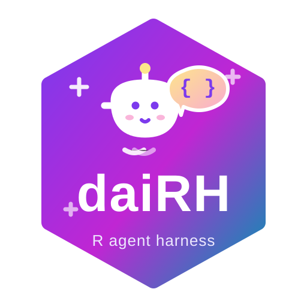

# daiRH — agentic coding assistant for RStudio



# daiRH — agentic coding assistant for RStudio

A conversational coding agent that lives in the **RStudio Viewer pane**,
built on `ellmer` + `shinychat`, and — more importantly — a real
**harness**: tool registry, pre/post hooks (intercept · argument rewrite
· result rewrite), a hard per-turn tool-call budget, and JSONL call
traces.

It runs any **OpenAI-compatible endpoint** (local Ollama, cloud
providers) and keeps the console free: the panel runs in an isolated
`callr` subprocess that talks back to the main R session over a local
capability bridge. Chinese speaker? The [main documentation is in
Chinese](https://gisersqdai.top/daiRH/).

## Install

``` codeblock
install.packages("remotes")
remotes::install_github("GISerDaiShaoqing/daiRH")
```

Requires R ≥ 4.1 and RStudio Desktop. After install and an R restart,
launch from `Tools → Addins → daiRH Chat`, configure provider/model/key
in `daiRH Settings`, or use the console CLI with `daiRH::dairh_cli()`.

## Features

###### Built-in toolset

Twelve tools out of the box: read/list/create/edit files, run R in an
isolated subprocess, R help lookup, workspace summary, editor context,
plotting, interactive HTML, skills, sub-agents. File operations default
to the project directory.

###### Runtime governance

Prompt advice becomes enforced rules: hard step budget per user turn,
hooks that can veto or rewrite arguments/results, and full JSONL
traceability of every tool call (main and sub agents on one timeline). A
plan/build mode switch trims mutation tools at runtime — read-only
becomes a fact, not advice. New sessions start with a project brief
snapshot (git state, directory tree, workspace summary) seeded into the
system prompt. One-click context compaction shows progress, fully backs
up the session store beforehand as a restorable entry, and the status
bar reports context occupancy as the full prompt (input plus cache hits
— billing-gateway accurate) with per-request usage, duration and output
speed appended to a JSONL log.

###### Images in chat

Plots are returned directly into the conversation as text + image
content — rendered inline in the chat, persisted with session history,
and usable for vision-capable models to keep analyzing. Gracefully
degrades when `magick` is unavailable.

###### Sub-agent delegation

The agent can delegate self-contained subtasks to an isolated context
(own step budget, one-level recursion lock) — batch checks and research
errands don't eat the main conversation.

###### Skills library

Drop Markdown files into a conventional directory and they become agent
skills, loaded on demand (progressive disclosure, nothing resident in
the context).

###### Session history & compaction

A drawer lists/searches/reopens past conversations; reopening the panel
rehydrates the latest chat, including prior tool calls. Long sessions
can be compacted on demand: the model summarizes the conversation and
the context is replaced by that summary, with the original chat archived
in the drawer. Trace and history directories are configurable.

## Function reference

The full function reference is maintained in Chinese on the main site —
index: [函数参考](https://gisersqdai.top/daiRH/reference/index.md). The
function names and signatures are universal, and each page shows the
call usage in code form.

Release notes:
[版本记录（Chinese）](https://gisersqdai.top/daiRH/news/index.md).
English summaries of major releases are coming along with the bilingual
rollout.

daiRH is developed by [Shaoqing
Dai](https://github.com/GISerDaiShaoqing)
([ORCID](https://orcid.org/0000-0003-0858-4728)) and released as open
source. [中文站](https://gisersqdai.top/daiRH/) ·
[GitHub](https://github.com/GISerDaiShaoqing/daiRH)
